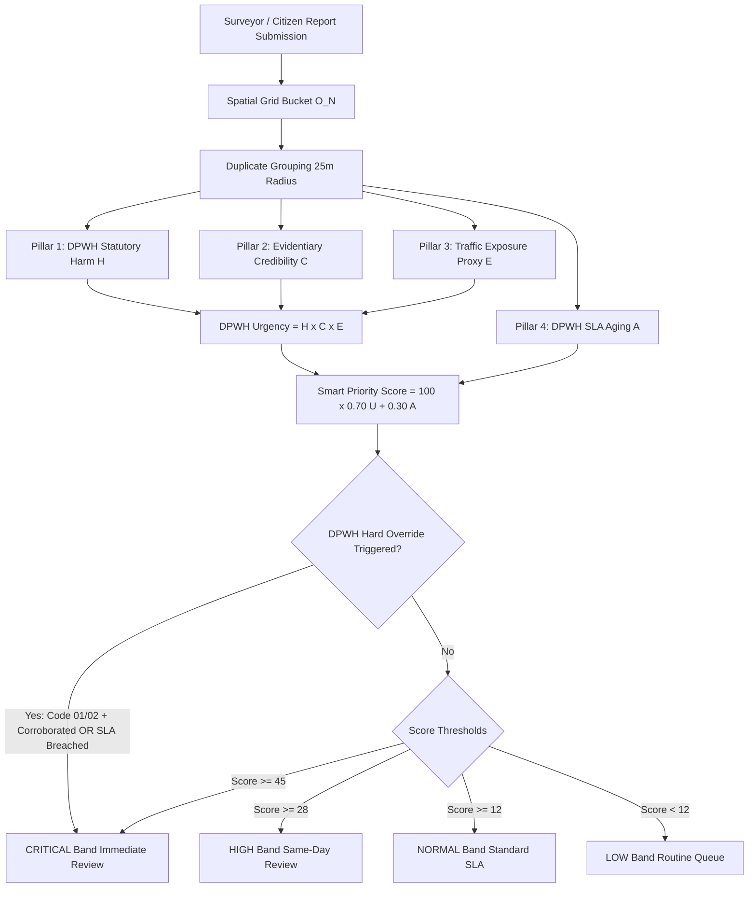
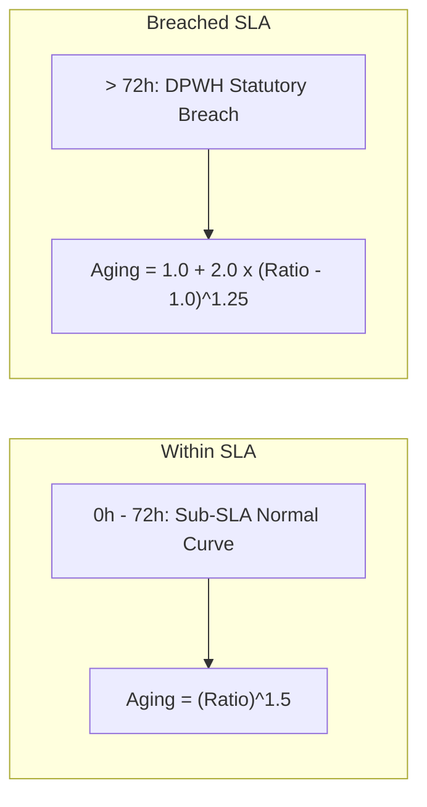

# DPWH Road Distress Priority & Triage Algorithm Documentation
**System:** RoadSense AI Pavement Inspection & GIS Platform  
**Compliance Standards:** DPWH Highway Maintenance Manual (HMM) & Department Orders on Performance Standards  
**Target Module:** [`lib/approval_priority.dart`](file:///c:/Users/jenar/ssdd/flutter/lib/approval_priority.dart) & [`lib/admin_dashboard_screen.dart`](file:///c:/Users/jenar/ssdd/flutter/lib/admin_dashboard_screen.dart)  
**Version:** 2.0 (DPWH Statutory Protocol Release)

---

## 1. Executive Summary & Engineering Objective

In municipal and provincial road maintenance operations, public crowdsourcing and automated vehicle surveying generate large volumes of reported pavement defects. If reports are reviewed purely in **First-In, First-Out (FIFO)** order or by raw subjective user claims, administrative resources become severely misallocated:
- High-risk physical emergencies (e.g., deep potholes on high-speed arterial roads) get buried behind low-severity surface hairline cracks reported days earlier.
- False reports, blurry captures, or duplicate submissions waste engineering inspection hours.

The **RoadSense DPWH Priority & Triage Algorithm** is an automated, mathematically rigorous prioritization engine grounded directly in **Department of Public Works and Highways (DPWH)** statutory standards. It scores, groups, and ranks all pending road hazard submissions so road engineers and maintenance administrators address statutory emergencies first.

---

## 2. DPWH Statutory Road Distress Classification Matrix

The algorithm strictly classifies each distress instance according to the **DPWH Highway Maintenance Performance Standards**:

| DPWH Code | Defect Class | Statutory SLA Mandate | Defect Weight ($W_{\text{dpwh}}$) | Corrective Engineering Measure | Operational Risk Assessment |
| :--- | :--- | :--- | :--- | :--- | :--- |
| **CODE 01** | **Pothole** | **3 Days (72 Hours)** | **1.00** | Bituminous premix (hot) or penetration patching; add base course material if depth $> 50\text{ mm}$. | High impact on motorcycle stability; rim/tire blowout risk; high water intrusion rate into road foundation. |
| **CODE 02** | **Alligator Crack** | **3 Days (72 Hours)** | **0.90** | Deep asphalt premix patching; base correction of weakened area. | Structural fatigue failure; interconnecting cracks allow rapid subgrade collapse into potholes. |
| **CODE 05** | **Depression** | **30 Days (720 Hours)** | **0.55** | Pavement re-blocking / replacement of concrete slabs including base leveling. | Surface settlement; causes severe vehicle bouncing, hydroplaning, and water ponding during rains. |
| **CODE 12** | **Longitudinal Crack** | **60 Days (1440 Hours)** | **0.35** | Crack sealing with hot/cold elastomeric sealant. | Joint and thermal stress fissures; preventative maintenance prevents subgrade saturation. |
| **CODE 12** | **Transverse Crack** | **60 Days (1440 Hours)** | **0.35** | Crack sealing with hot/cold elastomeric sealant. | Perpendicular shrinkage cracks; routine sealing scheduled within seasonal maintenance windows. |

> [!IMPORTANT]
> Under DPWH statutory protocol, **CODE 01** and **CODE 02** represent emergency safety obligations. Failure to inspect and approve corrective measures within 72 hours constitutes non-compliance under maintenance audit guidelines.

---

## 3. Mathematical Formulation

The prioritization score is determined by a hybrid **Multiplicative Gating** and **Non-Linear Statutory Aging** model:

$$\Large \text{DPWH Urgency} = H \times C \times E$$

$$\Large \text{Priority Score} = 100 \times \Big( 0.70 \times \text{DPWH Urgency} + 0.30 \times A \Big)$$

### Why Multiplicative Urgency?
Urgency is multiplicative ($H \times C \times E$) because the three factors **gate each other**:
- If an unverified user reports a "High Severity" hazard without a photo or model detection, credibility $C \approx 0.15$. The total urgency collapses to near zero.
- Additive models fail here because a high severity claim would inappropriately elevate junk reports to the top of the queue.

### Why Additive Aging?
Aging $A$ is **additive and uncapped**:
- Even if a hairline crack has moderate credibility and low exposure, it cannot be starved at the bottom of the queue forever. As time passes, aging steadily lifts the item until it reaches administrative review.

---

## 4. The 4 Algorithmic Pillars

### Pillar 1: DPWH Statutory Harm Index ($H$)
The physical danger and engineering urgency of the defect:

$$H = \text{clamp}\Big( 0.50 \times W_{\text{dpwh}} + 0.30 \times W_{\text{sev}} + 0.20 \times \text{Scale}, \, 0.20, \, 1.00 \Big)$$

1. **$W_{\text{dpwh}}$ (Statutory Defect Weight)**:
   - `CODE 01`: $1.00$
   - `CODE 02`: $0.90$
   - `CODE 05`: $0.55$
   - `CODE 12`: $0.35$
2. **$W_{\text{sev}}$ (Surveyor Assessment Weight)**:
   - `high`: $1.00$
   - `medium`: $0.60$
   - `low`: $0.30$
3. **$\text{Scale}$ (Cluster Density Multiplier)**:
   $$\text{Scale} = \text{clamp}\left(\frac{\ln(\text{count})}{\ln(6)}, \, 0.0, \, 1.0\right)$$
   Logarithmic saturation prevents a report with 20 potholes from overpowering the entire system, while correctly reflecting that a cluster of $3+$ potholes is substantially more hazardous than an isolated defect.

---

### Pillar 2: Evidentiary Credibility ($C$)
Validates whether the report reflects an authentic physical road distress before spending public funds on site verification:

$$C = \text{clamp}\Big( \big(0.42 \times \text{ModelConf} + 0.33 \times \text{Trust} + 0.25 \times \text{Corroboration}\big) \times \text{PhotoMultiplier}, \, 0.15, \, 1.00 \Big)$$

1. **Model Confidence ($\text{ModelConf}$)**:
   $$\text{ModelConf} = 0.5 \times \max(\text{confidences}) + 0.5 \times \text{mean}(\text{confidences})$$
   Balances peak confidence (detecting the most acute distress feature) with overall bounding box clarity.
2. **Reporter Bayesian Reliability ($\text{Trust}$)**:
   $$\text{Trust} = \frac{\text{Approved} + 2}{\text{Approved} + \text{Rejected} + 3}$$
   Implements a $\text{Beta}(2,1)$ prior. A brand-new reporter starts with a neutral score of $0.667$. Verified reports incrementally raise trust toward $1.0$, while spam/rejected submissions depress the score toward $0.20$.
3. **Independent Spatial Corroboration ($\text{Corroboration}$)**:
   $$\text{Corroboration} = 1 - 0.55^w$$
   Where $w$ is the count of **distinct other surveyor UIDs** who reported a hazard within a $25\text{ m}$ radius. A single user cannot self-corroborate.
4. **Photo Multiplier**:
   $$\text{PhotoMultiplier} = \begin{cases} 1.0 & \text{if valid photo URL is present} \\ 0.5 & \text{if no photo submitted} \end{cases}$$

---

### Pillar 3: Spatial Traffic Exposure Proxy ($E$)
Determines how many motorists and commuters are exposed to the pavement hazard:

$$E = 0.40 + 0.60 \times \min\left(1.0, \, \frac{\text{Nearby Reporters within } 300\text{ m}}{5}\right)$$

- On remote, rural local access roads with zero nearby surveyor activity: $E = 0.40$.
- On busy commercial thoroughfares and arterial highways with $\ge 5$ active nearby users: $E = 1.00$.

---

### Pillar 4: Non-Linear DPWH SLA Aging & Non-Compliance Escalation ($A$)
Rather than using an arbitrary flat timer, aging is measured directly against the defect's **DPWH Statutory SLA** ($\text{dpwhSlaHours}$):

$$\text{SLA Ratio} = \frac{\text{Waiting Time (Hours)}}{\text{dpwhSlaHours}}$$

$$\Large A = \begin{cases} 
\big(\text{SLA Ratio}\big)^{1.5} & \text{if } \text{Waiting Hours} \le \text{dpwhSlaHours} \\
1.0 + 2.0 \times \big(\text{SLA Ratio} - 1.0\big)^{1.25} & \text{if } \text{Waiting Hours} > \text{dpwhSlaHours} \text{ (SLA Breached)}
\end{cases}$$

> [!WARNING]
> Once a **CODE 01** Pothole exceeds its 72-hour window, the non-compliance penalty accelerates rapidly, ensuring that overdue emergency hazards surface to the top of the admin triage interface regardless of other incoming submissions.

---

## 5. DPWH Statutory Hard Overrides

The algorithm implements statutory safety bypass rules where a weighted average must not dilute the urgency:

1. **Corroborated Emergency Defect Rule**:
   $$\text{If } (\text{severity} == \text{'high'} \lor \text{dpwhCode} == \text{'CODE 01'}) \land w \ge 2 \implies \mathbf{CRITICAL}$$
   *Rationale*: When multiple independent citizens or surveyors confirm a deep pothole on an active road, administrative delay is unacceptable.
2. **Overdue Statutory Breach Rule**:
   $$\text{If } \text{dpwhCode} == \text{'CODE 01'} \land \text{isSlaBreached} \land \text{hasPhoto} \land \text{modelConf} \ge 0.40 \implies \mathbf{CRITICAL}$$
   *Rationale*: Any verified unpatched pothole older than 3 days triggers an emergency DPWH non-compliance escalation.

---

## 6. Priority Triage Bands & Response Protocols

| Band | Score Threshold | SLA Standard | Action Required in Admin Portal |
| :--- | :--- | :--- | :--- |
| **Critical** | $\text{Score} \ge 45$ (or Hard Override) | **$< 4$ Hours** | Immediate dispatch of road maintenance crew; instant approval to publish on live navigational map. |
| **High** | $\text{Score} \ge 28$ | **$< 24$ Hours** | Same-day engineering review; verification of physical pavement condition. |
| **Normal** | $\text{Score} \ge 12$ | **$< 48$ Hours** | Standard administrative queue processing. |
| **Low** | $\text{Score} < 12$ | **Routine Window** | Routine maintenance batch review. |

---

## 7. Spatial Deduplication & Cluster Management ($25\text{ m}$)

When road users encounter a hazardous pothole, multiple independent submissions occur at approximately the same GPS coordinates. 

The algorithm executes an $O(N)$ spatial grid hash:
- All pending reports within a **$25\text{ m}$ radius** are linked to each other via `duplicateIds`.
- The Admin Dashboard displays a **`N DUPLICATES`** tag.
- Approving or rejecting the primary item allows the administrator to resolve all duplicates in a single unified action.

---

## 8. Admin Portal Visual Indicators

In [`AdminDashboardScreen`](file:///c:/Users/jenar/ssdd/flutter/lib/admin_dashboard_screen.dart#L4842), each queue item renders the following real-time compliance indicators:

1. **`DPWH OVERDUE` Alert Pill**: Renders with an overdue timer icon in vivid red (`#EF4444`) whenever $\text{waitHours} > \text{dpwhSlaHours}$.
2. **DPWH Defect Tag**: Displays `CODE 01: Pothole`, `CODE 02: Alligator crack`, etc., in official standardized colors.
3. **Statutory Response SLA**: Displays `SLA: 3 Days`, `SLA: 30 Days`, or `SLA: Routine Maintenance`.
4. **Dynamic Explanation Reason Chips**:
   - `DPWH SLA OVERDUE (4.1d / 3d)`
   - `DPWH Code 01: 3-Day Emergency SLA`
   - `DPWH Critical Overdue Escalation`
   - `Corroborated Hazard (3 witnesses)`
   - `Trusted Surveyor`

---

## 9. Worked Numerical Examples

### Scenario A: Emergency Corroborated Pothole (Fresh, 4 Hours Old)
- **Defect**: `CODE 01` Pothole, `severity = high`, `count = 2`.
- **Credibility**: Photo present, YOLOv8s confidence $= 0.88$, Trusted surveyor ($12$ approved / $1$ rejected $\to \text{trust} = 0.875$), $2$ independent witnesses within $25\text{ m}$ ($\text{corro} = 1 - 0.55^2 = 0.698$).
- **Exposure**: $4$ active reporters nearby ($\text{nearby} = 4 \implies E = 0.40 + 0.60 \times 0.80 = 0.88$).
- **Aging**: $4\text{ hours} \implies \text{Ratio} = 4 / 72 = 0.056 \implies A = (0.056)^{1.5} = 0.013$.

$$\text{Harm } H = 0.50(1.0) + 0.30(1.0) + 0.20(0.387) = 0.8774$$
$$\text{Credibility } C = 0.42(0.88) + 0.33(0.875) + 0.25(0.698) = 0.833$$
$$\text{Urgency } U = 0.8774 \times 0.833 \times 0.88 = 0.643$$
$$\text{Score} = 100 \times \big(0.70(0.643) + 0.30(0.013)\big) = \mathbf{45.4} \implies \mathbf{CRITICAL}$$
*(Also triggers the **Hard Override** due to Code 01 $+$ $2$ witnesses).*

---

### Scenario B: Overdue Code 01 Pothole (Breached Statutory SLA, 96 Hours Old)
- **Defect**: `CODE 01` Pothole, `severity = medium`, `count = 1`.
- **Credibility**: Photo present, YOLO confidence $= 0.65$, Neutral reporter ($\text{trust} = 0.667$), $0$ witnesses ($\text{corro} = 0.0$).
- **Exposure**: Isolated road ($\text{nearby} = 0 \implies E = 0.40$).
- **Aging**: $96\text{ hours} \implies \text{Wait} > 72\text{ hours}$ (**SLA Breached**):
  $$\text{Ratio} = 96 / 72 = 1.333$$
  $$A = 1.0 + 2.0 \times (1.333 - 1.0)^{1.25} = 1.0 + 2.0 \times (0.333)^{1.25} = 1.0 + 2.0(0.254) = \mathbf{1.508}$$

$$\text{Harm } H = 0.50(1.0) + 0.30(0.6) + 0.20(0) = 0.680$$
$$\text{Credibility } C = 0.42(0.65) + 0.33(0.667) = 0.493$$
$$\text{Urgency } U = 0.680 \times 0.493 \times 0.40 = 0.134$$
$$\text{Score} = 100 \times \big(0.70(0.134) + 0.30(1.508)\big) = 100 \times (0.0938 + 0.4524) = \mathbf{54.6} \implies \mathbf{CRITICAL}$$

> [!NOTE]
> Even though this pothole is on an isolated road with no other witnesses, its **overdue DPWH SLA breach ($96\text{h} / 72\text{h}$)** pushes the score past $50$, ensuring road engineers prioritize this non-compliant defect before legal liability or structural road base collapse occurs.
